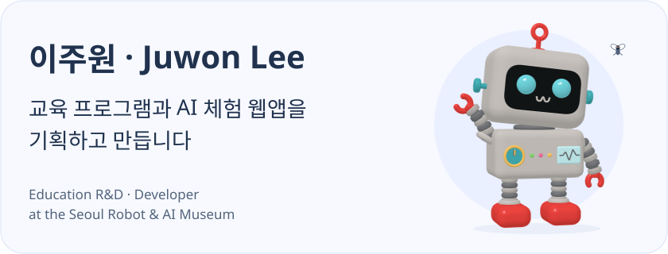
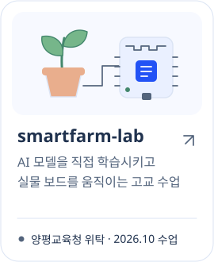
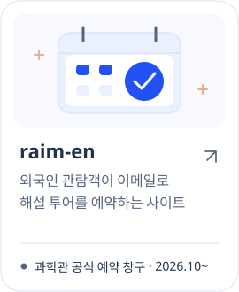
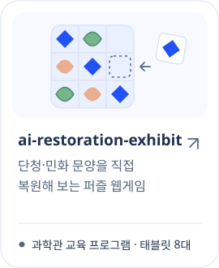

  <picture>
    <source media="(prefers-color-scheme: dark) and (max-width: 600px)" srcset="assets/lymee-hero-mobile-dark.svg">
    <source media="(max-width: 600px)" srcset="assets/lymee-hero-mobile-light.svg">
    <source media="(prefers-color-scheme: dark)" srcset="assets/lymee-hero-dark.svg">
    
  </picture>

### 만든 것

  <a href="https://juwonlee.dev/work/smart-farm-education"><picture><source media="(prefers-color-scheme: dark)" srcset="assets/smartfarm-dark.svg"></picture></a>
  <a href="https://juwonlee.dev/work/raim-en"><picture><source media="(prefers-color-scheme: dark)" srcset="assets/raim-en-dark.svg"></picture></a>
  <a href="https://github.com/henna2022/doctor-green"><picture><source media="(prefers-color-scheme: dark)" srcset="assets/doctor-green-dark.svg"></picture></a>

  <a href="https://github.com/henna2022/raim-ai-studio"><picture><source media="(prefers-color-scheme: dark)" srcset="assets/ai-studio-dark.svg"></picture></a>
  <a href="https://github.com/henna2022/ai-restoration-exhibit"><picture><source media="(prefers-color-scheme: dark)" srcset="assets/restorer-dark.svg"></picture></a>
  <a href="https://github.com/henna2022/raim-flybrain"><picture><source media="(prefers-color-scheme: dark)" srcset="assets/flybrain-dark.svg"></picture></a>

  <a href="https://juwonlee.dev">포트폴리오 · juwonlee.dev</a> · <a href="https://www.linkedin.com/in/juwon-lee-677b702b3/">LinkedIn</a> · <a href="mailto:hello@juwonlee.dev">hello@juwonlee.dev</a>

